# CODD Desktop

CODD 是個人開發的非官方工具，與 Anthropic 無關；Claude 與 Claude Code 是 Anthropic 的商標。

CODD Desktop 是一個原生的 macOS App，讓你在同一個視窗裡同時開啟、查看與切換很多個 Claude Code session。它只在你的 Mac 上執行：CODD 本身不連任何伺服器、沒有遠端存取，也不呼叫 Anthropic 的 API。每個終端機都由一個獨立的小程式 `codd-holder` 持有，所以結束、更新甚至當掉 CODD，session 都會繼續執行，下次打開 CODD 時自動接回。

版本 1.0.0。沒有預先建置好的下載檔，請依照下面的「安裝」在自己的 Mac 上從原始碼建置。完整的使用說明在 [docs/USER-GUIDE.zh-TW.md](docs/USER-GUIDE.zh-TW.md)。

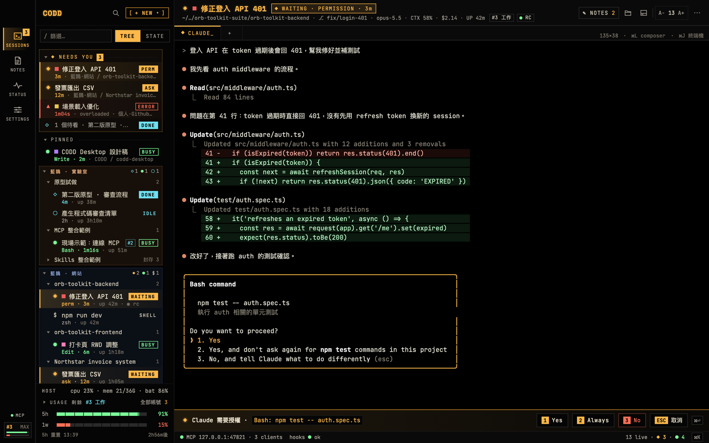

主視窗：左側依群組與專案整理 session，右側是正在等你授權的 claude session，底部有 Yes、Always、No 回答列。

## 畫面

<table>
  <tr>
    <td width="50%">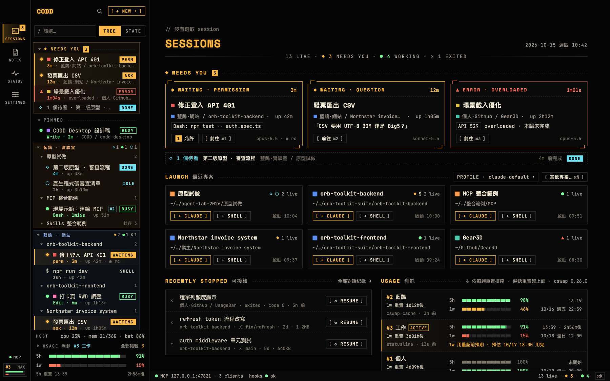<br>Home 把需要你處理的 session、最近的專案、可接續的對話與各帳號剩餘用量放在同一頁。</td>
    <td width="50%">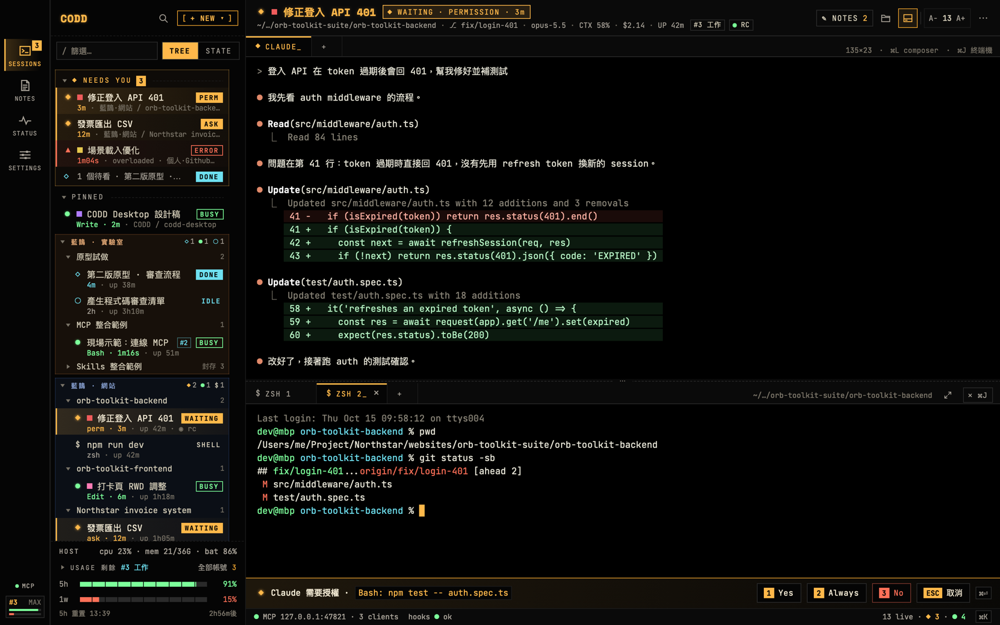<br>按 ⌘J 打開 session 下方的終端機面板，可以在同一個專案目錄開好幾個 shell 分頁。</td>
  </tr>
  <tr>
    <td>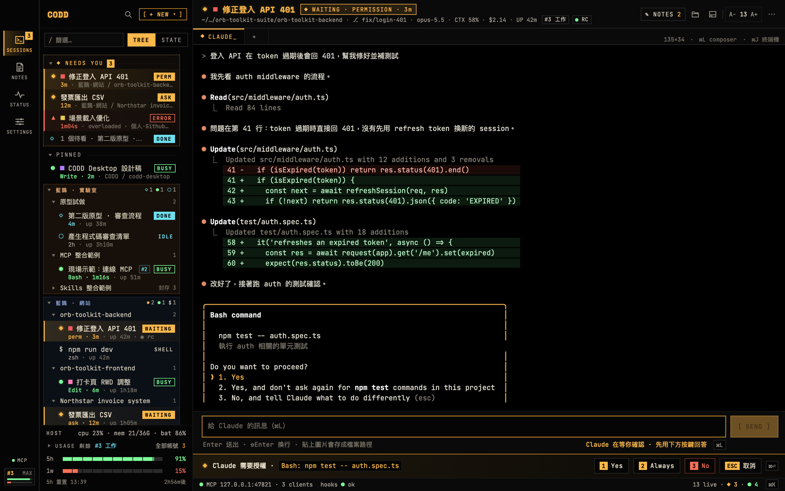<br>Composer（⌘L）在終端機下方撰寫較長的 prompt，Enter 送出、⇧Enter 換行。</td>
    <td>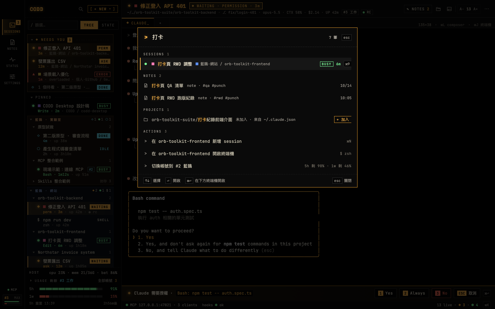<br>⌘K 快速切換同時搜尋 session、筆記、專案與動作，用鍵盤就能直接開啟。</td>
  </tr>
  <tr>
    <td>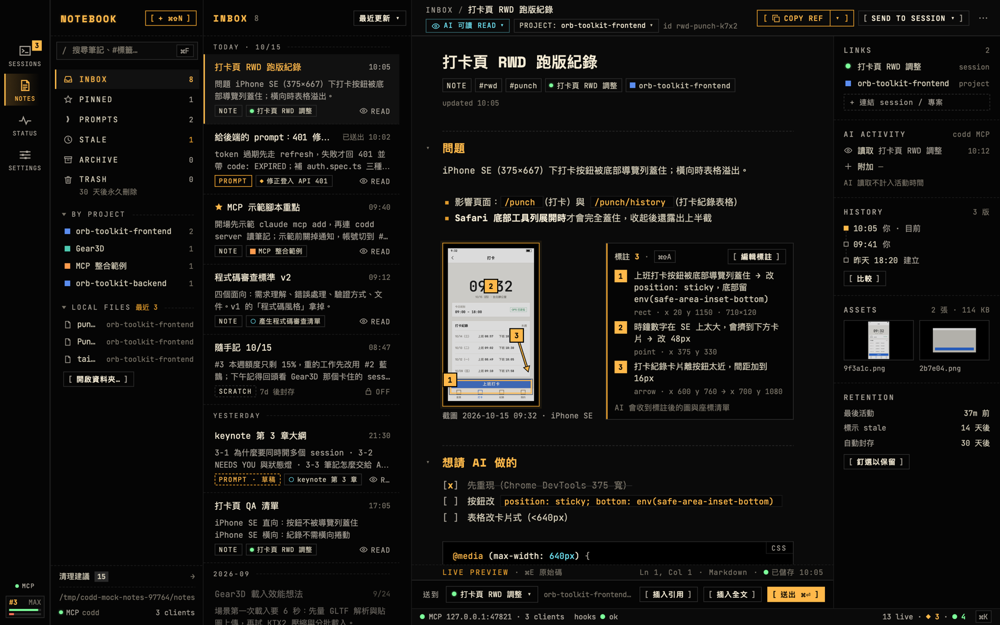<br>筆記本以 Markdown 即時預覽顯示筆記，右側有連結、AI 活動、修改歷史、圖片標註與保留設定。</td>
    <td>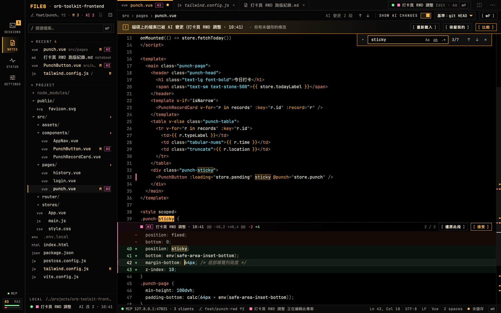<br>檔案編輯器有檔案樹、git 狀態、Claude 改過的檔案的 <code>AI</code> 標記，以及和 git HEAD 比較的 SHOW AI CHANGES。</td>
  </tr>
  <tr>
    <td>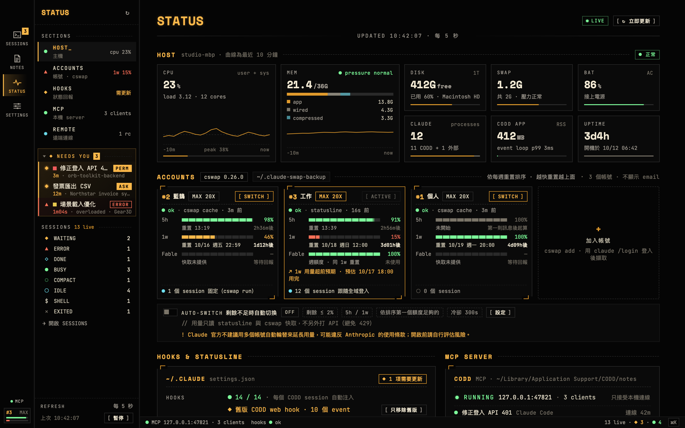<br>STATUS 頁彙整主機狀態、各帳號的 5 小時與每週用量、自動切換設定，以及 hooks 與 MCP server 的狀況。</td>
    <td>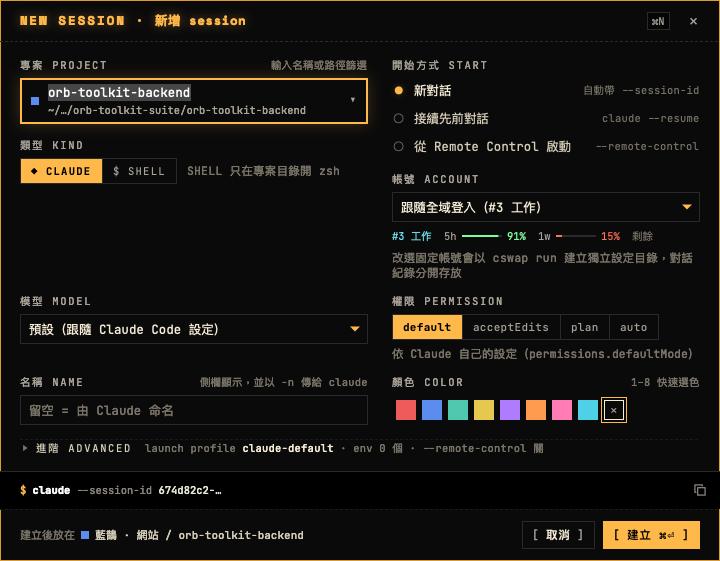<br>⌘N 新增 session：選專案、開始方式、帳號、權限與顏色，下方即時預覽將執行的 claude 指令。</td>
  </tr>
  <tr>
    <td>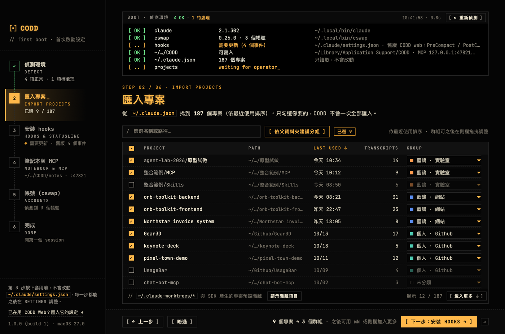<br>首次啟動設定的第 2 步從 <code>~/.claude.json</code> 列出可匯入的專案，勾選後依群組整理。</td>
    <td>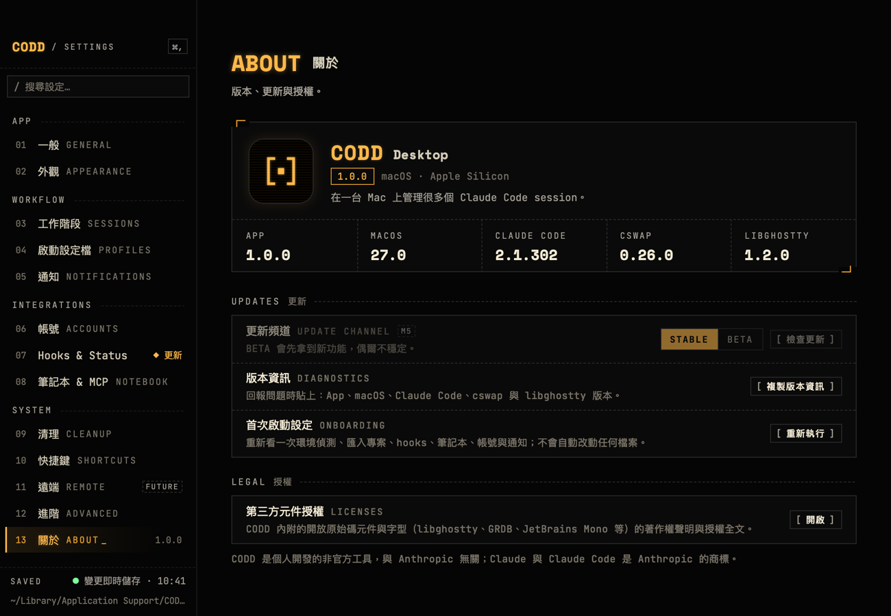<br>設定 › 關於 列出版本資訊與第三方元件授權。</td>
  </tr>
</table>

畫面裡的專案、session 與帳號都是內建的示範資料。

## 主要功能

- **側欄與狀態燈號**：依群組、專案、session 整理所有 session，燈號的形狀與顏色一起表示狀態（WAITING、ERROR、DONE、BUSY、IDLE、STOPPED 等）。在等你授權或出錯的 session 集中在最上方的 NEEDS YOU；在 CODD 以外啟動的 claude 也會以 `EXT` 列出（只讀取狀態）。
- **真正的終端機**：以 libghostty（Ghostty 的終端機引擎）繪製。Claude 要求授權時，終端機下方出現 `[1] Yes` `[2] Always` `[3] No` 回答列，按 ⌘⏎ 直接允許。每個 session 還有下方終端機面板（⌘J），可以開好幾個 shell 分頁。
- **session 不會中斷**：結束、更新或當掉 CODD 都不會停止 session；重開機後，停止的 claude session 可以按 RESUME，用 `claude --resume` 接回同一段對話。
- **Composer（⌘L）**：在終端機下方撰寫比較長的 prompt。注音等輸入法還在組字時按 Enter 只會確認選字、不會送出；多行內容當成一則送出，草稿與歷史都會保存；貼上的截圖會存成檔案，以路徑交給 claude。
- **⌘K 快速切換**：同時搜尋 session、筆記、專案與動作，用鍵盤直接開啟。
- **筆記本**：筆記是一般的 Markdown 檔，有即時預覽編輯、圖片標註（編號的框、點、箭頭與文字）、修改歷史與比較。每則筆記可以設定 AI 存取（OFF、READ、APPEND）；在 prompt 裡寫 `codd://note/<id>`，CODD 會在 Claude 讀到 prompt 之前自動附上筆記內容。
- **MCP server**：內建、只聽 127.0.0.1，提供 `notes_search`、`notes_list`、`notes_read`、`notes_append`、`notes_create`（打開 `AI 可寫入` 時另有 `notes_write`）。CODD 開的 claude session 會自動掛上；也可以註冊到 Claude Code，讓 CODD 以外開的 claude 也能讀筆記。
- **檔案編輯器**：在 CODD 裡打開專案的檔案，有檔案樹、git 狀態、Claude 改過的檔案的 `AI` 標記，以及和 git HEAD 比較的 SHOW AI CHANGES。只有按 ⌘S 才會寫入，原本的編碼與換行都保留。
- **多個帳號（cswap）**：透過 cswap 管理多個 Claude 帳號，只顯示別名、不顯示 email。列出每個帳號 5 小時與每週的剩餘用量（來自 Claude Code 自己回報的狀態列與 cswap 的快取，CODD 不呼叫用量 API），點一下就切換；也可以開啟「剩餘不足時自動切換」（預設關閉）。
- **選單列與 Dock**：選單列面板列出帳號、需要你處理的 session 與主機狀態，Dock 徽章顯示等待中的數量。session 需要你回覆或出錯、而你不在畫面前時發通知，可以設定勿擾時段或暫停通知 1 小時。
- **清理與保留**：很久沒動的筆記會標成 STALE、再自動封存，停止很久的 session 也會自動封存，每一步都能復原；清理頁可以批次封存，或把幾則筆記交給 Claude 濃縮成一則摘要（用你的帳號執行一次 `claude -p`）。
- **首次啟動設定**：六個步驟偵測環境、從 `~/.claude.json` 匯入專案、整理 hooks、設定筆記本與 MCP、讀取 cswap 帳號、允許通知。

## 系統需求

| 項目 | 需求 |
|---|---|
| 作業系統 | macOS 26.0 以上 |
| 建置工具 | Xcode 27（Swift 6.4），以及隨附的 git |
| xcodegen | Xcode 專案由 `project.yml` 產生，沒有放進儲存庫：`brew install xcodegen`（需要 [Homebrew](https://brew.sh)） |
| 網路 | 第一次建置時，Swift Package Manager 會從 GitHub 下載相依套件：libghostty-spm（含預先建置好的 `GhosttyKit.xcframework`）、DisplayLink 與 GRDB.swift，版本固定在 `App/Package.resolved` |
| Claude Code | 要開 claude session 時需要：`claude` 在登入 shell 的 PATH 裡，或在 `~/.local/bin/claude` |
| cswap（選用） | 要管理多個 Claude 帳號時需要 0.26 以上：`uv tool install claude-swap`（沒有 uv 時先 `brew install uv`）。沒有 cswap 也能用 CODD，session 會用目前登入的帳號 |

## 安裝

CODD 預設用 ad-hoc 簽章，而且沒有經過 Apple 公證（notarization）；這樣的 App 從網路下載後會被 macOS 的 Gatekeeper 擋下，所以 CODD 不提供建置好的下載檔，而是在你自己的 Mac 上從原始碼建置。整個建置、簽章與安裝的流程由 `scripts/release.sh --install` 一次完成。

### 1. 安裝 Xcode

從 App Store 安裝 Xcode 27，裝好後打開一次，讓它安裝額外的元件並同意授權條款。接著確認命令列工具用的是這個 Xcode：

```bash
xcode-select -p
```

應該顯示 `/Applications/Xcode.app/Contents/Developer`。如果顯示的是 `/Library/Developer/CommandLineTools`（只裝了 Command Line Tools），請執行：

```bash
sudo xcode-select -s /Applications/Xcode.app/Contents/Developer
```

### 2. 安裝 xcodegen

```bash
brew install xcodegen
```

### 3. 取得原始碼

```bash
git clone https://github.com/Wcc723/codd-desktop.git
cd codd-desktop
```

### 4. 建置並安裝

在一般的「終端機」App 裡（不要在 Claude Code 的 session 裡），於專案資料夾執行：

```bash
scripts/release.sh --install
```

它會依序：

1. 檢查需要的工具（`xcodebuild`、`codesign`、`ditto`、`git`、`security` 等）；Xcode 專案還不存在或比 `project.yml` 舊時，先執行 `xcodegen generate`。
2. 把 `App/Package.resolved` 放進產生的 Xcode 專案，以 Release 設定建置，而且只用這份檔案固定的相依套件版本（`-onlyUsePackageVersionsFromResolvedFile`）：上游的版本標籤被改指到別的 commit 時建置會失敗，不會連結到另一份程式碼，預先建置好的 libghostty 也一樣。完整紀錄寫在 `build/release/xcodebuild.log`。版本來自 `VERSION`（目前是 1.0.0），建置編號是 git 的 commit 數。
3. 簽章：預設用 ad-hoc 簽章，鑰匙圈裡的憑證不會自動被拿來用。只有加上 `--identity "<憑證名稱>"`（或設定 `RELEASE_IDENTITY`）時才改用你的 Apple Development 或 Developer ID 憑證；這時憑證上的姓名與 Team ID 會寫進簽章，拿到這個 App 或 zip 的人都讀得到。內建的三個輔助程式（`codd-holder`、`codd-hook`、`codd-statusline`）先簽，App 最後簽，再用 `codesign --verify --strict --deep` 檢查。沒有公證，也沒有 App 內自動更新。
4. 產生 `build/release/CODD.app` 與 `build/release/CODD-<版本>-<建置編號>.zip`。
5. 安裝：新版先複製到 `/Applications/.CODD.app.installing`，原本的 `/Applications/CODD.app`（如果有）用 `/usr/bin/trash` 移到垃圾桶（需要時可以「放回原處」），確定舊版移走後才改名放好。移不走舊版時它會停下來，兩個版本都留在原處。

建置花了多久會顯示在輸出裡（`xcodebuild ok in … s`、`done in … s`）；第一次建置要先下載相依套件，請保持網路連線。最後一行 `RELEASE app=… zip=… version=… build=… identity=… bundle=…` 是這次的結果，`identity=adhoc` 表示用了 ad-hoc 簽章。

安裝在下列情況會被拒絕（結束碼 3），`/Applications/CODD.app` 不會被改動：

- 在 Claude Code 的 shell 裡執行（環境變數 `CLAUDECODE` 存在時）：安裝只由你自己進行。
- `/Applications/CODD.app` 正在執行：先在 CODD 按 ⌘Q，選 `結束 · session 繼續執行`（session 不會停）。
- 指定了 `--output`：`--install` 只安裝 `build/release` 裡的建置。

其他用法：

```bash
scripts/release.sh --dry-run                  # 只列出會執行的每個步驟，不建置任何東西
scripts/release.sh                            # 只建置到 build/release，不安裝
scripts/release.sh --output <資料夾>          # 建置到另一個資料夾（不能搭配 --install）
scripts/release.sh --identity "<憑證名稱>"    # 用你的憑證簽章，不用 ad-hoc
```

- `--output` 的資料夾在這個專案裡時只能放在 `build/` 底下（其他位置的 zip 與紀錄檔會被 git 收進去），也不能是 `/Applications` 或 `~/Applications`。
- `<憑證名稱>` 可以是 `security find-identity -v -p codesigning` 列出的完整名稱、只對應到一張憑證的一部分名稱，或它的 SHA-1；`-` 表示 ad-hoc。

## 第一次啟動

從「應用程式」資料夾打開 CODD。這台 Mac 第一次使用 CODD 時，會先出現「首次啟動設定」視窗，走完或關掉它之後才出現主視窗：

| 步驟 | 做什麼 |
|---|---|
| 1 偵測環境 · DETECT | 檢查 claude、cswap、`~/.claude/settings.json` 的 hooks、CODD 的資料夾能不能寫入，以及 MCP 位址。不寫入任何東西 |
| 2 匯入專案 · IMPORT PROJECTS | 從 `~/.claude.json` 列出你用 Claude Code 開過的專案（只讀），勾選的專案加進側欄，也可以依上層資料夾分組 |
| 3 安裝 hooks · HOOKS & STATUSLINE | CODD 開的 session 本來就會自動帶上 hooks 與狀態列，不必改全域設定。這一步只整理 `~/.claude/settings.json`（移除舊版 CODD web 留下的 hooks，或安裝選用的全域狀態列），按 `套用並備份` 才寫入，寫入前先備份 |
| 4 筆記本與 MCP · NOTEBOOK & MCP | 顯示筆記的位置與 MCP 狀態；可以把 MCP 註冊到 Claude Code（寫入 `~/.claude.json` 前先備份） |
| 5 帳號 (cswap) · ACCOUNTS | 讀取 cswap 的帳號，只顯示別名 |
| 6 完成 · DONE | `[允許通知]` 讓 CODD 在 session 需要你時提醒你；`[開始使用 →]` 打開主視窗 |

每一步都可以 `[略過]`，之後在 SETTINGS 調整；要再跑一次，用選單 `說明 › 首次啟動設定…`。

- **資料放在哪裡**：所有資料都在 `~/Library/Application Support/CODD`（側欄、設定、session、`notes/` 筆記等），更新 CODD 時保留。每一項的說明見使用說明第 12 節。
- **通知權限**：在第 6 步按 `[允許通知]`，或第一次有通知要發時，macOS 會問你；之後在 系統設定 › 通知 › CODD 調整。
- **加入專案**：除了第 2 步匯入，也可以按 ⌘N，在 PROJECT 選 `+ 選擇資料夾…`，或從 Finder 把資料夾拖到側欄。
- **開第一個 session**：按 ⌘N，選 CLAUDE 或 SHELL、帳號、模型與權限，按 `[建立 ⌘⏎]`。
- 關掉主視窗後 CODD 仍留在選單列與 Dock 上，session 照常執行；要完全結束 CODD 請按 ⌘Q。

想先看看流程、不動到真正的資料，可以讓 CODD 用一個空的暫存資料夾：

```bash
T="$(mktemp -d)"
mkdir -p "$T/root" "$T/claude/sessions"
/Applications/CODD.app/Contents/MacOS/CODD -codd-data-root "$T/root" -codd-claude-dir "$T/claude"
```

在這種資料夾上，CODD 刻意不找 claude 與 cswap，首次啟動設定也不會自動出現（用 `說明 › 首次啟動設定…` 打開）。用完按 ⌘Q 結束，再刪掉 `$T`。

## 更新

1. 在 CODD 按 ⌘Q，選 `結束 · session 繼續執行`。CODD 還開著時安裝會被拒絕，所以請在一般的「終端機」App 裡更新，不要在 CODD 自己的終端機分頁裡執行。
2. 進入專案資料夾，更新原始碼後重新安裝：

   ```bash
   git pull
   scripts/release.sh --install
   ```

3. 從「應用程式」資料夾打開 CODD：session 自動接回，設定 › 關於 會顯示新的版本與建置編號。

- 舊版會移到垃圾桶。資料檔都有版本號，比較舊的格式會先備份再轉換（使用說明 13.2）。
- 用 ad-hoc 簽章時，macOS 以每次建置的簽章認 App，所以專案放在「桌面」、「文件」、「下載項目」或網路磁碟上時，每次更新後都可能再問一次是否允許 CODD 存取。

## 解除安裝

CODD 只在你明確按下的動作時才改動自己資料夾以外的檔案（使用說明 12.2 有完整清單）。解除安裝前，先在 CODD 裡把它們改回來：

1. 安裝過全域狀態列時：設定 › Hooks & Status 的 `[解除安裝]`，在 Hook 差異 對話框按 `套用並備份`。
2. 把 MCP 註冊到 Claude Code 時：設定 › 筆記本 & MCP › 註冊 的 Claude Code `[移除]`（拿掉 `~/.claude.json` 裡的 `mcpServers.codd`）。
3. 開過 `登入時啟動` 時：在 設定 › 一般 把它關掉。
4. 按 ⌘Q；有 session 在跑時選 `[全部停止並結束]`，停止所有 session 之後才結束（選 `結束 · session 繼續執行` 的話，session 會留在背景繼續跑）。
5. 把 `/Applications/CODD.app` 移到垃圾桶。
6. 要連資料一起刪除：刪掉 `~/Library/Application Support/CODD`。這裡面有你的筆記（`notes/`）與所有 session 的資料，刪除前請先備份需要的筆記。

不會自動刪掉的東西：

- CODD 寫入前留下的備份 `~/.claude/settings.json.codd-bak-*` 與 `~/.claude.json.codd-bak-*`，不需要時可以自己刪除。
- Claude Code 自己的對話紀錄（`~/.claude/projects/`）與 cswap 的資料，它們屬於 Claude Code 與 cswap。
- macOS 裡的通知權限與登入項目（系統設定 › 通知、系統設定 › 一般 › 登入項目）。

同樣的步驟也在 [使用說明 13.5](docs/USER-GUIDE.zh-TW.md#135-解除安裝)。

## 安全性

claude session 的 hook 事件與 CODD 的 MCP server 都走本機的 `http://127.0.0.1:47821`（預設的連接埠），每個請求都帶著 CODD 執行時產生的 token。只有你一個人用的 Mac 不必另外處理。

和其他使用者帳號共用的 Mac 上要注意：CODD 沒在監聽這個連接埠時（例如選了 `結束 · session 繼續執行`，或 CODD 正在重新啟動），別的帳號的程式可以先佔住它，收到 session 的 hook 事件（包含 prompt 與工具的輸入），也能回覆這些事件，例如直接允許工具執行。在這種 Mac 上建議：

- 結束 CODD 時選 `[全部停止並結束]`，不讓 session 留在背景。
- 不要把 MCP 註冊到 Claude Code（設定 › 筆記本 & MCP），也不要安裝全域狀態列（設定 › Hooks & Status）；這兩項會讓 CODD 以外開的 claude 也連到這個連接埠。

## 開發

建置、測試、手動試用與發行的完整說明在 [docs/DEVELOPMENT.md](docs/DEVELOPMENT.md)（英文），包括自動化測試與 agent 必須遵守的安全規則：測試只用暫存資料夾，不碰你的 `~/.claude`、`~/.claude.json` 與 CODD 的資料，也不執行真正的 claude 或 cswap。最常用的幾個指令：

```bash
# App（Debug，輸出到 build/dd）
xcodegen generate && xcodebuild -project CODD.xcodeproj -scheme CODD -configuration Debug -derivedDataPath build/dd build

# 單一套件的測試（每個套件用自己的 scratch path，避免 SwiftPM 的鎖互相卡住）
swift test --package-path Packages/CoddCore --scratch-path .build-core

# 文案檢查（不可有 emoji、email、簡體字等）
python3 -I scripts/tools/copy-audit.py
```

改了什麼該跑哪些測試見 [scripts/TEST-MAP.md](scripts/TEST-MAP.md)；在這個儲存庫工作的 Claude Code session 另外遵守 [CLAUDE.md](CLAUDE.md)。

## 文件

- [docs/USER-GUIDE.zh-TW.md](docs/USER-GUIDE.zh-TW.md)：使用說明（安裝、首次啟動、每個功能、資料位置、更新與解除安裝、疑難排解）。
- [docs/DEVELOPMENT.md](docs/DEVELOPMENT.md)：建置、測試、安全規則、手動試用、發行、效能預算與儲存庫結構。
- [docs/ARCHITECTURE.md](docs/ARCHITECTURE.md)：架構決策、process model、資料夾內容、測試用的旗標、holder wire protocol v1、效能預算。
- [design/SPEC.md](design/SPEC.md)：產品與 UX 規格（§8 v2、§9 v3 與 §10 優先於前面的章節）。
- [scripts/TEST-MAP.md](scripts/TEST-MAP.md)：改了什麼該跑哪些測試。
- [CLAUDE.md](CLAUDE.md)：給在這個儲存庫工作的 Claude Code session 的建置指令與規則。
- [docs/ROADMAP.md](docs/ROADMAP.md)，以及各里程碑的 `docs/M<n>-PLAN.md` 與 `docs/M<n>-REPORT.md`。

## 授權

CODD Desktop 以 [MIT License](LICENSE) 釋出。內嵌或隨 App 發行的第三方程式碼與字型保有各自的授權，見下一節。

## 第三方元件

- **libghostty**（`GhosttyKit.xcframework`，經由 libghostty-spm 連結）：由 [Ghostty](https://ghostty.org) 建置，MIT License，Copyright (c) 2024 Mitchell Hashimoto, Ghostty contributors。
- **libghostty-spm** 的 Swift wrapper（macOS 部分，內嵌在 `Packages/CoddTerminal/Sources/GhosttyWrapper/`，CODD 的修改標有 `CODD:`）：[Lakr233/libghostty-spm](https://github.com/Lakr233/libghostty-spm)，MIT License，Copyright (c) 2026 @Lakr233。
- **DisplayLink**：[Lakr233/DisplayLink](https://github.com/Lakr233/DisplayLink)，MIT License，Copyright (c) 2024 Lakr Aream。
- **GRDB.swift**（筆記的搜尋索引）：[groue/GRDB.swift](https://github.com/groue/GRDB.swift)，MIT License，Copyright (C) 2015-2025 Gwendal Roué。
- **JetBrains Mono**（`App/Fonts/`，授權全文 `App/Fonts/OFL-JetBrainsMono.txt`）：SIL Open Font License 1.1，Copyright 2020 The JetBrains Mono Project Authors。
- **Space Mono**（`App/Fonts/`，授權全文 `App/Fonts/OFL-SpaceMono.txt`）：SIL Open Font License 1.1，Copyright 2016 Google Inc.

所有隨 App 發行的第三方元件與字型（包含 libghostty 內含的 Oniguruma、simdutf、GNU libintl 等程式庫）的授權全文見 [THIRD-PARTY-NOTICES.md](THIRD-PARTY-NOTICES.md)。App 裡也帶著這份檔案：設定 › 關於 › 第三方元件授權 按 `[開啟]` 就能看到。內嵌程式碼的來源版本見 [Packages/CoddTerminal/NOTICE](Packages/CoddTerminal/NOTICE)。

要把建置好的 CODD.app 或 zip 分享給別人時，請一併提供 libintl（LGPL-2.1）與 z2d（MPL-2.0）的原始碼：`scripts/release.sh` 壓好 zip 後會列出這兩個檔案的名稱、下載位置與 SHA-256，說明在 THIRD-PARTY-NOTICES.md 的「Source of the MPL-2.0 and LGPL-2.1 parts」。
